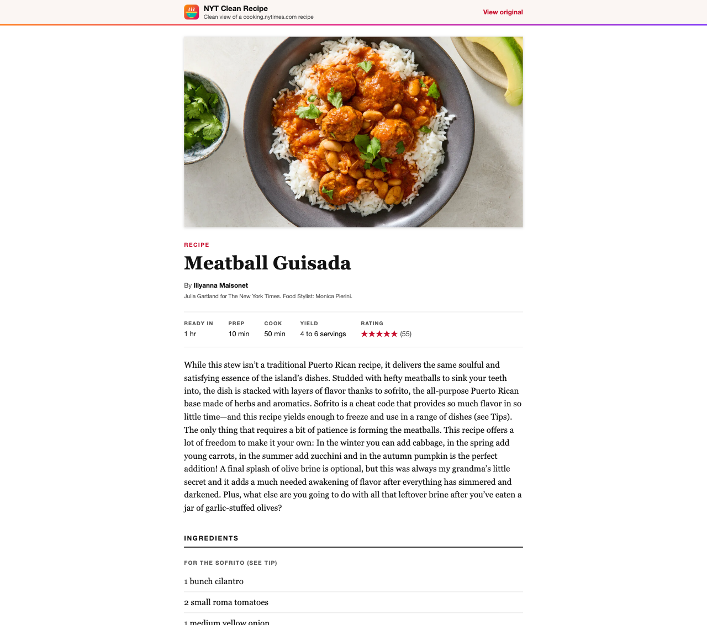
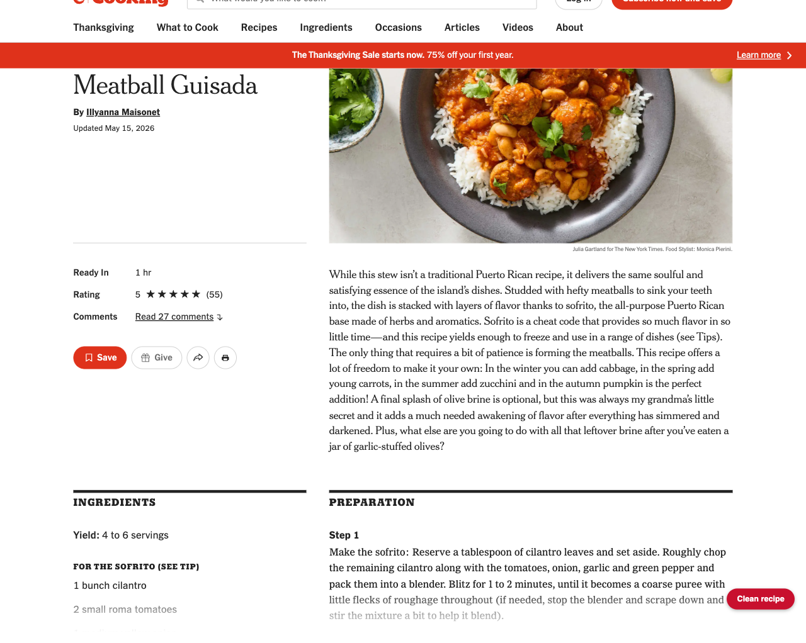

<p align="center"></p>

<h1 align="center">NYT Clean Recipe</h1>

<p align="center">Chrome extension (Manifest V3) that opens NYT Cooking recipes in a clean reading tab: title, photo, stats, intro, grouped ingredients, numbered steps and tips. No banners, promos or comments.</p>



## Usage

- **Recipe links.** On cooking.nytimes.com, click any recipe link. The recipe opens in a clean tab next to the current one. Alt+click (or Ctrl/Cmd/Shift+click) keeps the normal browser behaviour.
- **Page button.** Recipe pages get a "Clean recipe" button in the bottom-right corner.
- **Toolbar icon.** Enabled on recipe pages, greyed out everywhere else. Click it to open the current recipe.
- **Refresh.** Recipes are cached for the browser session. Append `&refresh=1` to a viewer URL to re-fetch.



## Install

1. Clone this repo.
2. Open `chrome://extensions` and enable **Developer mode**.
3. Click **Load unpacked** and select the repo folder.
4. After pulling changes, click the extension's reload arrow and reload open NYT Cooking tabs.

To build a zip for the Chrome Web Store or for sideloading:

```bash
./scripts/package.sh   # writes dist/nyt-clean-recipe-<version>.zip
```

## How it works

| File | Role |
|---|---|
| `src/extract.js` | `extractRecipe(doc, url)`: reads the page's `Recipe` JSON-LD (name, author, times, yield, rating, image, steps). Ingredient group headings and tips come from the server-rendered DOM via substring class selectors, falling back to the flat JSON-LD list. All extraction lives in this one function. |
| `src/content-links.js` | Capture-phase click handler on cooking.nytimes.com that redirects plain clicks on recipe links to the clean view. |
| `src/content.js` | Injects the floating "Clean recipe" button (closed shadow root) on recipe pages, including after in-site navigation. |
| `src/background.js` | Service worker. Opens the viewer tab, fetches recipe HTML with the browser's own session (`credentials: "include"`, cooking.nytimes.com only), and enables the toolbar icon only on recipe tabs. |
| `viewer/` | Extension page that parses the fetched HTML with `DOMParser`, caches the result in `chrome.storage.session`, and renders it with `textContent` only (never `innerHTML`). |

The viewer always parses the page source rather than the live tab, because the live page can be truncated by NYT's sign-in wall (tips go missing).

## Permissions

- `storage`: session cache of extracted recipes.
- `tabs`: read tab URLs to enable the toolbar icon and open the viewer next to the source tab.
- `activeTab`: toolbar click on the current tab.
- Host `https://cooking.nytimes.com/*`: content scripts and fetching recipe pages.

No analytics, no remote code, no third-party requests. Recipe photos load from `static01.nyt.com`.

## Tests

The extractor is tested with jsdom against saved recipe pages. The pages are downloaded locally and are not committed.

```bash
cd tests
npm install
npm run fetch-fixtures   # downloads 9 recipe pages into tests/fixtures/
npm test
```

The fixtures cover grouped and ungrouped ingredients, named and unnamed `HowToSection` steps, multiple authors, array-valued yield, missing ratings, and recipes with and without tips.

## Notes

This tool reformats pages your own browser already receives, for personal reading. It is not affiliated with The New York Times. Do not redistribute recipe content. If NYT changes its JSON-LD or markup, update `extractRecipe` in `src/extract.js` and re-run the tests.
